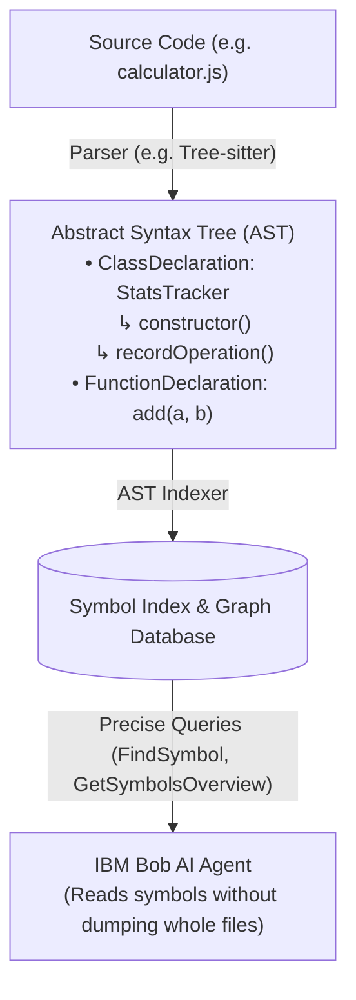

# Lab 1: Workspace Setup & Context Exploration

**Duration:** 30 minutes
**Goal:** Understand how IBM Bob reads workspace context, resolves symbols, obeys project constraints defined in [`AGENTS.md`](../AGENTS.md), and plans multi-step tasks.
**IBM Bob Version:** Authored with **IBM Bob 2.2.3**

> **📖 IBM Bob Documentation References:**
> - [Custom Rules & `AGENTS.md`](https://bob.ibm.com/docs/ide/configuration/rules) (`docs/ide/configuration/rules`)
> - [Start a Project with `/init` & `AGENTS.md`](https://bob.ibm.com/docs/ide/tutorials/start-a-project) (`docs/ide/tutorials/start-a-project`)
> - [Context Window Management](https://bob.ibm.com/docs/ide/core-concepts/context-window-management) (`docs/ide/core-concepts/context-window-management`)
> - [Ignoring Files with `.bobignore`](https://bob.ibm.com/docs/ide/configuration/bobignore) (`docs/ide/configuration/bobignore`)
> - [Auto-approving Actions (permissions)](https://bob.ibm.com/docs/ide/features/auto-approving-actions) (`docs/ide/features/auto-approving-actions`)
> - [Security Guidance](https://bob.ibm.com/docs/ide/security/bob-security-guidance) (`docs/ide/security/bob-security-guidance`)

> **🧭 Where do I type?** 💬 = type into the **Bob chat** (agentic sidebar). 🖥️ = type into a **terminal you open** (**Terminal → New Terminal**). 📝 = edit a **file in the editor**. Never paste shell commands into the chat. See [Where Do I Type This?](README.md#where-do-i-type-this-chat-vs-terminal-vs-editor).

> **💡 Name your Bob tasks.** When starting a new task in Bob, give it a short descriptive title (e.g. `"Lab 1 - Context exploration"`). The title is used when exporting session history to `task-history/`. Unnamed tasks export as `NN_unnamed_task/`.

---

## 1. Objectives

By the end of this lab, you will:
- Understand how Bob reads local configuration and rules without manual context feeding.
- Control what Bob may do on its own through the permissions (Auto-Approve toolbar) in the agentic chat sidebar.
- Query symbols, functions, and cross-file relationships directly from chat.
- Learn how to instruct Bob using structured prompts and multi-file context.

---

## 2. Step-by-Step Instructions

### Step 1.0: Verify Workspace Trust
Lifecycle hooks (such as automatic task-history export) and extensions in IBM Bob require the workspace to be **Trusted**.

1. Verify that the current workspace is trusted. If the **Workspace Trust** banner or prompt appears, select **"Trust Workspace & Authors"**.
2. You can also verify or change trust status at any time via the Command Palette (`Cmd+Shift+P` / `Ctrl+Shift+P` -> `Workspaces: Manage Workspace Trust`).

---

### Step 1.1: Verify Workspace Configuration & Rules
IBM Bob reads workspace instructions such as [`AGENTS.md`](../AGENTS.md) automatically.

> **💡 Understanding `/init` vs Pre-configured Workspaces:**
> In a new or existing codebase without Bob configuration, you would typically run the `/init` command in Bob chat. `/init` scans the codebase and automatically generates a baseline [`AGENTS.md`](../AGENTS.md) and mode-specific rules.
>
> **⚠️ Do NOT execute `/init` in this workshop repository:**
> This template already includes a hand-crafted [`AGENTS.md`](../AGENTS.md) containing workshop-specific rules, scaffolding guidelines for Labs 1–3, and task history export hooks. Running `/init` now would overwrite [`AGENTS.md`](../AGENTS.md) with a generic scan and wipe out the pre-configured workshop instructions.

1. Open [`AGENTS.md`](../AGENTS.md) to inspect the pre-configured workshop guidelines.
2. 💬 **In the Bob chat**, submit:
   ```markdown
   What are the project rules and configurations defined for this workspace?
   ```
3. **Verification:** Confirm that Bob quotes [`AGENTS.md`](../AGENTS.md) accurately and explains its role as the persistent instruction set for this repository (including task history export rules, coding standards, and lab scaffolding constraints).

---

### Step 1.1b: Permissions in the Agentic Chat Sidebar
Before Bob changes files or runs commands, you decide what it may do on its own. Bob asks for your approval by default. The controls sit in the **Auto-Approve toolbar** directly above the chat input in the agentic chat sidebar.

1. 💬 **In the Bob sidebar** (no typing needed): hover over the **Auto-Approve toolbar** above the chat input and look at the available actions and their risk levels:

   | Action | What Bob may do without asking | Risk |
   | :--- | :--- | :--- |
   | **Read** | View files and directory contents | Medium |
   | **Edit** | Create, edit and save files | High |
   | **Execute** | Run commands in your terminal | High |
   | **MCP** | Use the MCP servers you configured (Lab 4) | Medium to High |
   | **Skill** | Activate skills | Medium |
   | **Todo**, **Subtask**, **Subagent**, **Mode** | Update the todo list, start subtasks and subagents, switch modes | Low |

2. **Recommended setting for this workshop (hybrid approach):**
   - Enable **Read**, so Bob can explore the workspace without a prompt on every file.
   - Keep **Edit**, **Execute** and **MCP** on manual approval. In the labs you create files, commit, push and call a database, so you should see each of these actions before it happens.
   - Low-risk actions (Todo, Subtask, Mode) can stay on auto-approve if you like.
3. **See how an approval prompt works.** 💬 **In the Bob chat**, prompt Bob:
   ```markdown
   List the files in the `workshop-documentation/` folder and tell me which command or tool you used.
   ```
   Then try a prompt that needs a terminal command, for example `Show me the current Git branch.` Bob proposes the command and waits. Prompts appear one at a time, and large diffs or outputs are collapsed into a preview you can expand.
   - **Approve** to run the action, or **Reject** to cancel it.
   - **Edit the command** in the approval prompt before approving if you want to change it (for example, to narrow `git add` to explicit paths in Lab 2).
4. **Task-level approvals:** You can set the tool group approvals for a single task. These appear first in the approval prompt and apply only to the current task, independent of your global settings.
5. **Protect sensitive files:** Auto-approve does not replace file protection. [`.bobignore`](../.bobignore) blocks Bob from reading or writing the paths listed there (currently `.env`, `.env.*`, and `task-history/`). In the optional Lab 6 you temporarily make `task-history/` readable for the compliance skill and restore it afterwards. In Lab 4 you will optionally add `.bob/mcp.json` to [`.bobignore`](../.bobignore) if you want to prevent Bob from editing it directly.

> **⚠️ Warning:** Auto-approve bypasses confirmation prompts and gives Bob direct access to your system. Command execution is especially risky because it can cause data loss or file corruption. Enable auto-approval only for actions you fully trust, and never auto-approve **Execute** for commands that push, delete or force-push (Lab 2).

> **MCP note (Lab 4):** MCP tool auto-approval is off by default and works per tool. The global **MCP** action in the toolbar must be enabled first. If it is off, no MCP tool is auto-approved, even if **Always allow** is checked for a tool.

**Verification:** You can name the Auto-Approve toolbar, say which actions you left on manual approval and why, and have seen Bob wait for your approval on a terminal command.

---


### Step 1.2: Exploring Code Navigation & Symbol Queries
> **📁 Where does generated code go?** All code you generate in the labs lives in its own folder under [`workshop-apps/`](../workshop-apps/), never in the repository root. Lab 1 uses `workshop-apps/lab-1-calculator/`. This rule is defined in [`AGENTS.md`](../AGENTS.md), so Bob follows it automatically.

1. Create a sample utility module to test context lookup. 💬 **In the Bob chat**, prompt Bob:
   ```markdown
   Create a utility file named `workshop-apps/lab-1-calculator/src/utils/calculator.js` with functions `add(a, b)`, `multiply(a, b)`, and a class `StatsTracker` that logs operation counts.
   ```
2. Once generated, 💬 **in the Bob chat**, ask Bob to inspect the symbol hierarchy:
   ```markdown
   Where is `StatsTracker` defined, and what methods are implemented in it?
   ```
3. **Verification:** Notice that Bob gives you exact file references [`calculator.js`](../workshop-apps/lab-1-calculator/src/utils/calculator.js) with clickable links and line numbers. The expected answer is: `StatsTracker` is defined in `calculator.js` at line 26, with the methods `constructor`, `record`, `getCount` and `getStats`.

   > **ℹ️ Expected variation:** Bob may first report that the symbol lookup (`FindSymbol`) found nothing, and then find `StatsTracker` with a text search. In a recorded run the answer was: *"StatsTracker is defined in calculator.js, starting at line 26. The symbol lookup found nothing, so I located it with a text search instead."* This is a correct result. The symbol index can be empty for a file Bob created a moment ago.

4. *(Optional)* Ask Bob to use the symbol tool explicitly and compare the answer:
   ```markdown
   Use the symbol overview tool on `workshop-apps/lab-1-calculator/src/utils/calculator.js` and list the top-level symbols.
   ```

---

### 💡 Optional Deep Dive: What is an AST Indexer? (background only)

> **You can skip this section.** It explains the idea behind symbol lookups. No later step depends on it.

An **Abstract Syntax Tree (AST)** is a tree data structure created by language parsers (e.g. Tree-sitter, TypeScript compiler) that represents the syntactic and semantic structure of source code. Instead of seeing code as plain text, the AST represents programming entities such as **classes**, **functions**, **methods**, **imports**, **variable scopes**, and **call hierarchies**.

An **AST Indexer**:
1. **Parses & Structures:** Parses source files into hierarchical syntax trees across the repository.
2. **Indexes Symbols:** Builds an index mapping symbol names (e.g. `StatsTracker`, `add`) to exact file paths and line numbers.
3. **Enables Semantic Navigation:** Allows Bob to locate definitions, find callers, and fetch structural outlines (e.g. class methods without bodies) without brute-force searching or consuming excessive LLM context tokens.



---

### Step 1.3: Multi-File Dependency Reference
1. 💬 **In the Bob chat**, instruct Bob to create a consumer file:
   ```markdown
   Create `workshop-apps/lab-1-calculator/src/app.js` that imports `StatsTracker` from `./utils/calculator.js`, performs 3 additions and 2 multiplications, and logs the summary.
   ```
2. 💬 **In the Bob chat**, ask Bob:
   ```markdown
   Which files reference `StatsTracker`?
   ```
3. **Verification:** Bob identifies [`app.js`](../workshop-apps/lab-1-calculator/src/app.js) and [`calculator.js`](../workshop-apps/lab-1-calculator/src/utils/calculator.js) and explains their relationship. Bob may use a text search for this too.

> **➡️ Before Lab 2:** your Lab 1 files are still uncommitted. Do **not** ask Bob to "commit the changes". Lab 2 (Step 2.0b) shows how to commit them with explicit paths.

---

## 3. Key Takeaways
- **Symbol tools with a text-search fallback:** Bob can use symbol tools (based on syntax trees) to resolve symbols and references. When the symbol index has no result, Bob falls back to a text search and still finds the code. Always check the file and line references in the answer.
- **Context Efficiency:** Symbol tools let Bob inspect hierarchies (e.g. class methods) without loading entire file contents into the LLM context window.
- **Persistent Workspace Rules:** Rules in [`AGENTS.md`](../AGENTS.md) and `.bob/rules/` are automatically loaded into every session to enforce project standards.
- **Project Bootstrapping (`/init`):** While `/init` is used to bootstrap new projects by auto-generating [`AGENTS.md`](../AGENTS.md), established or customized projects should preserve and edit [`AGENTS.md`](../AGENTS.md) manually to maintain specialized workflow rules.
