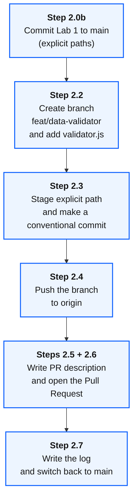

# Lab 2: Agentic Git & GitHub Workflows

**Duration:** 30 minutes
**Goal:** Use Bob to create a feature branch, write a conventional commit, push the branch, and open a pull request. Each step has a check, so you always know the state of your repository.
**IBM Bob Version:** Authored with **IBM Bob 2.2.3**

> **📖 IBM Bob Documentation References:**
> - [Version Control Best Practices](https://bob.ibm.com/docs/ide/getting-started/best-practices) (`docs/ide/getting-started/best-practices`)
> - [Code Reviews (`/review`)](https://bob.ibm.com/docs/ide/features/code-reviews) (`docs/ide/features/code-reviews`)
> - [Agentic Chat & Tool Execution](https://bob.ibm.com/docs/ide/features/chat-interface) (`docs/ide/features/chat-interface`)

> **🧭 Where do I type?** 💬 = **Bob chat** (agentic sidebar). 🖥️ = **your own terminal** (**Terminal → New Terminal**, repository root). 🌐 = **browser**. Never paste shell commands into the Bob chat and never paste chat prompts into the terminal. See [Where Do I Type This?](README.md#where-do-i-type-this-chat-vs-terminal-vs-editor).

> **💡 Name your Bob tasks.** When starting a new task in Bob, give it a short descriptive title (e.g. `"Lab 2 - Git workflow"`). The title is used when exporting session history to `task-history/` and is required for the AI Regulatory Compliance skill to produce accurate provenance records. Unnamed tasks export as `NN_unnamed_task/`.

---

## 1. Objectives

By the end of this lab, you will:
- Verify your Git remote and GitHub authentication **before** you start.
- Commit the Lab 1 work to `main` first, so it cannot leak into the feature branch or the PR.
- Understand why `task-history/` is never committed, and keep it out of Git with `.gitignore`.
- Create a feature branch and a small demo app in its own folder (`workshop-apps/lab-2-git-demo/`).
- Stage **explicit paths only** and create a conventional commit.
- Push the branch and open a pull request (PR), with fallbacks if authentication fails.
- Keep all PR artifacts in `workshop-git/lab-2-pr/` instead of the repository root.

---

## 2. Where Everything Goes

| What | Location | Committed in the PR? |
| :--- | :--- | :--- |
| Demo code for this lab | `workshop-apps/lab-2-git-demo/` | **Yes** |
| PR description (`pr-description.md`) | `workshop-git/lab-2-pr/` | No (local artifact, passed to the PR) |
| Step-by-step record (`GIT-WORKFLOW-LOG.md`) | `workshop-git/lab-2-pr/` | No (local artifact) |
| Bob task history exports | `task-history/` | **Never** (only `task-history/README.md` is tracked) |
| Code from Lab 1 | `workshop-apps/lab-1-calculator/` | Not in this PR. It is committed to `main` first in Step 2.0b. |
| Code from Lab 3 | `workshop-apps/lab-3-*` | **Never** in this PR |

These rules are also defined in [`AGENTS.md`](../AGENTS.md), so Bob follows them automatically. See [`workshop-git/README.md`](../workshop-git/README.md) for the folder description.



---

## 3. Step-by-Step Instructions

### Step 2.0: Prerequisites Check (do this first)
🖥️ **Open a terminal** (**Terminal → New Terminal**) and run these checks **there, not in the Bob chat**. They take one minute and prevent the most common failure in this lab: a pull request that cannot be created because of missing credentials.

1. 🖥️ **Terminal:** check that the repository has a remote:
   ```bash
   git remote -v
   ```
   *Expected: an `origin` entry pointing to **your** GitHub repository (created from the template).*
   If it is empty, add your repository: `git remote add origin https://github.com/<your-user>/<your-repo>.git`

2. 🖥️ **Terminal:** check that you are on `main` and the working tree state is known:
   ```bash
   git branch --show-current
   git status --short
   ```
   *Expected: `main`. Untracked entries such as `workshop-apps/lab-1-calculator/` are expected. You commit them in Step 2.0b. `task-history/` exports must **not** appear here (see Step 2.0b). Do **not** commit any other untracked folder in this lab.*

3. 🖥️ **Terminal:** check GitHub CLI authentication (recommended path for PR creation):
   ```bash
   gh --version
   gh auth status
   ```
   - If `gh` is missing: install it from [cli.github.com](https://cli.github.com/) (macOS: `brew install gh`).
   - If you are not logged in: run `gh auth login` and follow the interactive prompts **in your own terminal** (it opens a browser login; do not run it through the Bob chat).

4. **Handling tokens safely:**
   - Never paste a GitHub token into the Bob chat, into a Markdown file, or into a file that is committed.
   - If you use the **GitHub MCP server**, the token belongs only in your local [`.bob/mcp.json`](../.bob/mcp.json). Never commit a token in this file. To hide it from Bob, add it to [`.bobignore`](../.bobignore) (see Lab 4).
   - A GitHub MCP error `Authentication Failed: Bad credentials` means the token is missing, expired or has no `repo` scope. Create a new token with `repo` scope and update it in `.bob/mcp.json`, or use `gh` instead.

5. Record your choice. You need at least **one** of these three ways to open a PR in Step 2.6:
   - [ ] `gh` is installed and authenticated (recommended)
   - [ ] GitHub MCP server works with a valid token
   - [ ] You will open the PR manually in the browser (always possible after the push)

---

### Step 2.0b: Commit Your Lab 1 Work to `main` First
Do this **before** you create the feature branch. Uncommitted Lab 1 files would stay in your working tree while you switch branches, and a vague prompt such as "commit the changes" can pull them into the Lab 2 commit and the PR.

> **Why is `task-history/` never committed?** The exports contain your complete prompts, tool output, local paths and the repository name. They can contain secrets or personal data that appeared in a command output, they are specific to your machine, and every task turn rewrites them. Bob also cannot read them, because they are listed in [`.bobignore`](../.bobignore). Only [`task-history/README.md`](../task-history/README.md) belongs in the repository.

1. 🖥️ **Terminal:** check that Git ignores the exports and shows only the README. This is how the repository is configured (see the `task-history/*` rule in [`.gitignore`](../.gitignore)):
   ```bash
   git check-ignore -v task-history/example-export.json
   git status --short -uall | grep task-history
   ```
   *Expected: the first command names the `task-history/*` rule in `.gitignore`. The second command prints nothing (or only `task-history/README.md` if it is not committed yet). If you see export folders such as `task-history/01_...`, the rule is missing. Add these lines to `.gitignore`:*
   ```gitignore
   # Task history: keep only the README
   task-history/*
   !task-history/README.md
   ```
   *Do not use `task-history/` with a trailing slash plus a `!` line: Git cannot re-include a file inside an ignored folder, so the README would be ignored too.*

2. 💬 **In the Bob chat**, commit the Lab 1 work with explicit paths and push `main`. Pushing `main` matters: if Lab 1 stayed only in your local `main`, your pull request would contain the Lab 1 commit as well.
   ```markdown
   Stage ONLY `workshop-apps/lab-1-calculator/` with `git add workshop-apps/lab-1-calculator/` (never `git add .` or `git add -A`) and create a conventional commit on `main`. Do not stage `task-history/`, `workshop-git/`, `.bob/` or any other folder. Then push `main` to `origin`. Do not force-push.
   ```
   Approve each command in the approval prompt and read it before you approve.

3. 🖥️ **Terminal:** verify:
   ```bash
   git log -1 --stat
   git status -sb
   ```
   *Expected: one commit with only files under `workshop-apps/lab-1-calculator/`, and `## main...origin/main` without `ahead`.*

#### 🛠️ Attendee task: keep `.bob/mcp.json` out of Git (do this yourself, it is not part of the default configuration)
Your MCP configuration can hold tokens and local paths. In a previous run, Bob committed and pushed `.bob/mcp.json` when asked "Commit it and push it". The template deliberately leaves `# .bob/mcp.json` commented out in [`.gitignore`](../.gitignore), so you decide for your own repository.

1. 📝 **Editor:** open [`.gitignore`](../.gitignore) and remove the `#` in front of `.bob/mcp.json`, so the line reads `.bob/mcp.json`. *Alternative without touching the repository: add the line `.bob/mcp.json` to `.git/info/exclude`. That file is local and never committed.*
2. 🖥️ **Terminal:** verify:
   ```bash
   git check-ignore -v .bob/mcp.json
   ```
   *Expected: a line naming the rule. If the file is already tracked (`git ls-files .bob/mcp.json` prints a path), the ignore rule has no effect. Remove it from the index with `git rm --cached .bob/mcp.json` and commit that change.*
3. If you changed `.gitignore`, commit it in a separate commit with an explicit path (`git add .gitignore`). Do not push this change inside the Lab 2 feature branch.

---

### Step 2.1: Verify the Repository (no `git init` needed)
This template is already a Git repository, so you do **not** initialize a new one.

1. 💬 **In the Bob chat**, run:
   ```markdown
   Verify the Git repository state without changing anything: show the current branch, the remote URL, and whether `.gitignore` excludes `node_modules/`, `.env` and `*.db`. Do not modify any file.
   ```
2. 🖥️ **Terminal:** check yourself:
   ```bash
   git status
   cat .gitignore
   ```
   *Confirm that `.gitignore` contains entries for `node_modules/`, `.env`, `*.db` and `*.log`. If any are missing, add them now before continuing.*
3. *Alternative:* If you started from an empty folder instead of the template, run `git init -b main` and create a `.gitignore` containing `node_modules/`, `.env`, `*.db` and `*.log` first.

---

### Step 2.2: Feature Branch and Demo App (separate folder)
1. 💬 **In the Bob chat**, instruct Bob to start a new feature. The code goes into its own lab folder:
   ```markdown
   Create a new branch `feat/data-validator` from `main`. Then create a small Node.js module `workshop-apps/lab-2-git-demo/src/utils/validator.js` that checks if an object contains the required string fields (`id`, `name`). Do not create any file in the repository root.
   ```
2. 🖥️ **Terminal:** verify the branch:
   ```bash
   git branch --show-current
   ```
   *Expected output: `feat/data-validator`*
3. 🖥️ **Terminal:** verify the file location:
   ```bash
   git status --short
   ```
   *Expected: `?? workshop-apps/lab-2-git-demo/` appears. No new `src/` folder exists in the repository root.*

---

### Step 2.3: Semantic Commit (explicit paths only)
1. 💬 **In the Bob chat**, let Bob inspect the changes and write the commit. The staging scope is explicit:
   ```markdown
   Review the changes in `workshop-apps/lab-2-git-demo/`. Stage ONLY that folder with `git add workshop-apps/lab-2-git-demo/` (never `git add .` or `git add -A`) and create a conventional commit with an accurate summary. Do not stage `task-history/`, `workshop-git/` or any other lab folder.
   ```
2. 🖥️ **Terminal:** check the commit:
   ```bash
   git log -1 --stat
   ```
   *Expected: exactly one commit with only files under `workshop-apps/lab-2-git-demo/`.*
3. **Observation:** Notice how Bob follows conventional commit syntax (`feat(validator): add validateSchema ...`).
4. **If Bob answers "nothing to commit":** this is correct when the folder was already committed. Do not ask Bob to create an empty commit. Check `git log -1 --stat` instead.

---

### Step 2.4: Push the Branch
1. 💬 **In the Bob chat**, prompt Bob:
   ```markdown
   Push the branch `feat/data-validator` to `origin` with upstream tracking. Do not force-push.
   ```
2. 🖥️ **Terminal:** verify:
   ```bash
   git status -sb
   git log origin/feat/data-validator --oneline -3
   ```
   *Expected: `## feat/data-validator...origin/feat/data-validator` and your commit on top.*
3. The push output also prints a link of the form `https://github.com/<user>/<repo>/pull/new/feat/data-validator`. This is your manual fallback in Step 2.6.

---

### Step 2.5: Draft the Pull Request Description
1. 💬 **In the Bob chat**, prompt Bob to draft the description **into the Git artifact folder**:
   ```markdown
   Draft a complete Pull Request summary comparing `feat/data-validator` with `main`, based on `git diff main...feat/data-validator`. Write it to `workshop-git/lab-2-pr/pr-description.md`. Include:
   - Summary of Changes
   - Breaking Changes (if any)
   - Testing Checklist
   ```
2. 📝 **Editor:** open `workshop-git/lab-2-pr/pr-description.md` and review it. It must mention only the files in `workshop-apps/lab-2-git-demo/`.

---

### Step 2.6: Create the Pull Request (fallback ladder)

> **⚠️ The branch must be on GitHub before you can open a PR.** Do not proceed until you have confirmed the push in Step 2.4. If `git log origin/feat/data-validator --oneline -1` prints your commit, you are ready. If it fails with `unknown revision`, go back and push first — this is the most common failure in this lab: the PR API returns *"Head sha can't be blank, No commits between main and feat/data-validator"* when the branch does not exist on the remote yet.

Try the options in this order and stop at the first one that works.

**Option 1: GitHub CLI (recommended)** — 🖥️ **Terminal** (you type it, not Bob)
```bash
gh pr create --base main --head feat/data-validator \
  --title "feat: implement schema validator helper" \
  --body-file workshop-git/lab-2-pr/pr-description.md
```

**Option 2: GitHub MCP server through Bob** — 💬 **Bob chat**
```markdown
Create a pull request from `feat/data-validator` into `main` with the title "feat: implement schema validator helper" and the body from `workshop-git/lab-2-pr/pr-description.md`, using the GitHub MCP server. If it fails with an authentication error, stop and tell me; do not try to work around it.
```

**Option 3: Browser (always works after the push)** — 🌐 **Browser**
Open the `pull/new/feat/data-validator` link from Step 2.4, paste the content of `pr-description.md` into the description, and click **Create pull request**.

> **Approval:** Merging or approving a PR is a decision for you or a reviewer. Review the PR on GitHub yourself. Bob does not need to approve it.

> **📝 Record the method now.** Before moving to Step 2.7, note in the Bob chat how you opened the PR — for example: `"PR created via: gh CLI"`. Bob will use this in the next step to fill in the workflow log accurately. If you skip this, the log will show "unconfirmed" for the creation method.

---

### Step 2.7: Record the Result and Return to `main`
> If a pull request for this branch already exists and Bob did not create it, Bob cannot know how it was opened and writes "not recorded". Tell Bob first, for example: `The PR was created via: gh CLI`.

1. 💬 **In the Bob chat**, prompt Bob:
   ```markdown
   Create `workshop-git/lab-2-pr/GIT-WORKFLOW-LOG.md` with a table of: branch name, commit hash and message, push result, how the PR was created (gh / MCP / browser), PR URL or status, and any problems. Do not include tokens or secrets.
   ```
2. 🖥️ **Terminal:** switch back to `main` and confirm the state:
   ```bash
   git switch main
   git status -sb
   ```
   *Expected: `## main...origin/main`. The feature work stays on the branch and in the PR.*

---

## 4. What NOT to Do

| Do not | Why |
| :--- | :--- |
| `git add .` or `git add -A` | It stages Lab 3 code, `task-history/`, `.bob/mcp.json` and PR files into your PR. |
| "Commit everything and push" or "Commit it and push it" | This caused a PR with 22 unrelated files in a previous run, and in another run `.bob/mcp.json` was pushed to `main`. Always name the paths. |
| Commit or push without naming the branch | Bob may push to `main`. Name the branch and say whether pushing is allowed. |
| Commit anything from `task-history/` | The exports hold full prompts and tool output. Only the README is tracked. |
| Put `pr-description.md` or logs in the repository root | They belong in `workshop-git/lab-2-pr/`. |
| `git push --force` | It rewrites the remote history. Only do it knowingly and after you confirm it. |
| Paste tokens into chat or Markdown | They can leak through task history exports and commits. |
| Ask Bob to "remove what is needed" | Vague prompts lead to unrequested resets and deletions. Say exactly what to undo. |

---

## 5. If Something Goes Wrong

| Symptom | Fix |
| :--- | :--- |
| `gh: command not found` | Install `gh` (`brew install gh`) or use Option 2 or 3 in Step 2.6. |
| MCP error `Authentication Failed: Bad credentials` | Token missing, expired or without `repo` scope. Create a new token and update `.bob/mcp.json`, or use `gh` / the browser. |
| A wrong file is in the commit, **not yet pushed** | `git reset --soft HEAD~1`, then unstage with `git restore --staged <path>` and commit again with explicit paths. |
| A wrong file is in the commit, **already pushed** | Tell Bob exactly what to undo. Prefer `git revert <hash>` (adds a new commit, safe). Use a force-push only if you understand the effect and approve it explicitly. |
| The PR contains unrelated commits | Check `git log main..feat/data-validator --oneline`. Fix with a revert commit, or create a fresh branch from `main` and cherry-pick the right commit. |
| You are on the wrong branch | `git switch main` (or `git switch feat/data-validator`). Check with `git branch --show-current`. |
| Untracked files remain after the lab | Leave them (for example `workshop-apps/lab-3-*` and `workshop-git/`). They are intentionally not part of the PR. |
| `task-history/01_...` folders show up in `git status` | The `task-history/*` rule is missing from `.gitignore`. See Step 2.0b. |
| `.bob/mcp.json` was committed or pushed | Remove it from the index with `git rm --cached .bob/mcp.json`, commit that change, and add the ignore rule (Step 2.0b task). If it contained a real token, revoke and replace the token: it stays in the Git history. |

---

## 6. Key Takeaways
- Check remote and authentication first. Most PR failures are credential problems, not Git problems.
- Explicit staging keeps each PR small and reviewable.
- Bob executes Git operations in the terminal or through MCP tools, and the commit message and PR description are grounded in real `git diff` output.
- Generated code, Git artifacts and task history each have their own folder, so nothing leaks into your commit by accident.
