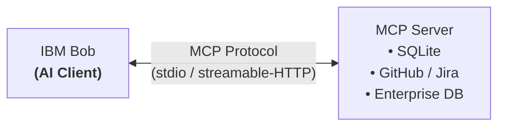
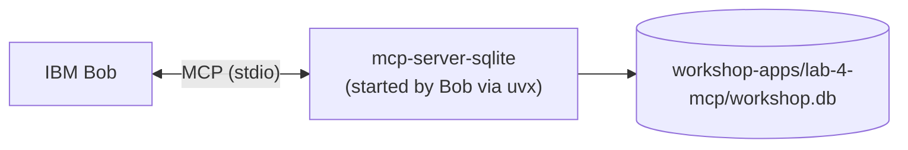
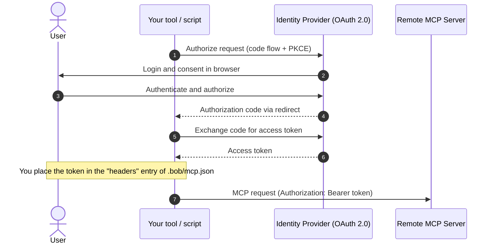

# Lab 4: Extending Bob with MCP Servers

**Duration:** 45 minutes
**Goal:** Configure, query, and secure Model Context Protocol (MCP) servers in IBM Bob, exploring both local tool execution and authenticated remote servers.
**IBM Bob Version:** Authored with **IBM Bob 2.2.3**

> **📖 IBM Bob Documentation References:**
> - [Using MCP in Bob](https://bob.ibm.com/docs/ide/configuration/mcp/mcp-in-bob) (`docs/ide/configuration/mcp/mcp-in-bob`)
> - [Understanding MCP Architecture](https://bob.ibm.com/docs/ide/configuration/mcp/understanding-mcp) (`docs/ide/configuration/mcp/understanding-mcp`)
> - [MCP Security & Enterprise Guidance](https://bob.ibm.com/docs/ide/security/bob-security-guidance) (`docs/ide/security/bob-security-guidance`)

> **🧭 Where do I type?** 💬 = **Bob chat** (agentic sidebar). 🖥️ = **your own terminal** (**Terminal → New Terminal**, repository root). 📝 = **file in the editor**. Never paste shell commands into the Bob chat. See [Where Do I Type This?](README.md#where-do-i-type-this-chat-vs-terminal-vs-editor).

> **💡 Name your Bob tasks.** When starting a new task in Bob, give it a short descriptive title (e.g. `"Lab 4 - SQLite MCP"`). The title is used when exporting session history to `task-history/`. Unnamed tasks export as `NN_unnamed_task/`.

---

## 1. Objectives

By the end of this lab, you will:
- Understand the architecture of Model Context Protocol (MCP) in IBM Bob.
- Register a local SQLite MCP server (`mcp-server-sqlite`, started by Bob via `uvx`) that stores its data in `workshop-apps/lab-4-mcp/workshop.db`, and query it through natural language.
- Understand how a remote MCP server is registered with an `Authorization` header, how to keep that token out of Git, and where OAuth 2.0 fits in.

---

## 2. Step-by-Step Instructions

### Step 4.1: Understanding MCP Architecture
MCP defines an open standard for AI models to discover and interact with tools, resources, and prompt templates.



---

### Step 4.2: Registering a Local SQLite MCP Server

**What is the MCP server here?** The SQLite database (`workshop.db`) is only a file. The *MCP server* is a small program, [`mcp-server-sqlite`](https://pypi.org/project/mcp-server-sqlite/), that Bob starts as a child process (stdio). It opens the database file and offers Bob tools such as `list_tables`, `create_table`, `write_query` and `read_query`. Bob never touches the file directly; it calls these tools.



> **⚠️ Package note:** The package `@modelcontextprotocol/server-sqlite` that older instructions use **does not exist on npm** (`npx` fails with `404 Not Found`). The SQLite MCP server is a Python package on PyPI and is started with `uvx`. With the newest `mcp` library it fails at startup (`AttributeError: 'Server' object has no attribute 'list_resources'`). Pinning `mcp<2` works (verified with `mcp-server-sqlite 2025.4.25`).

1. 🖥️ **Terminal:** check that `uv` is installed (it provides `uvx`):
   ```bash
   uvx --version
   ```
   If missing: macOS `brew install uv`, or see [docs.astral.sh/uv](https://docs.astral.sh/uv/getting-started/installation/).
2. 🖥️ **Terminal:** create the lab folder and get its absolute path (generated files never go in the repository root; the database is saved in this folder):
   ```bash
   mkdir -p workshop-apps/lab-4-mcp
   echo "$(pwd)/workshop-apps/lab-4-mcp/workshop.db"
   ```
   Copy the printed path. Use an absolute path, because the working directory of the MCP server process is not guaranteed to be your repository.
3. 📝 **Editor:** open [`.bob/mcp.json`](../.bob/mcp.json) in your editor and add the server entry below. The template does not ship this file: if it does not exist yet, create it. If it exists, keep any servers already present. Bob can create this file itself, for example with a `bob-marketplace` entry (a local URL and a token header). Add `workshop-db` **next to** such an entry; do not replace it. The file can hold tokens and local paths, so never commit a token in it. You can also add `.bob/mcp.json` to [`.bobignore`](../.bobignore) if you want to prevent Bob from reading or editing it. Example, replace the path with the one from step 2:
   ```json
   {
     "mcpServers": {
       "workshop-db": {
         "command": "uvx",
         "args": [
           "--with", "mcp<2",
           "mcp-server-sqlite",
           "--db-path", "/ABSOLUTE/PATH/TO/REPO/workshop-apps/lab-4-mcp/workshop.db"
         ]
       }
     }
   }
   ```
   > **🛠️ Attendee task (not part of the default configuration): keep `.bob/mcp.json` out of Git.** The template leaves `# .bob/mcp.json` commented out in [`.gitignore`](../.gitignore) on purpose. If you did not do it in [Lab 2, Step 2.0b](lab-2-git-workflows.md), do it now: remove the `#` in `.gitignore` (or add `.bob/mcp.json` to `.git/info/exclude`) and check it with `git check-ignore -v .bob/mcp.json`. A prompt such as "Commit it and push it" would otherwise push the file, including its local paths and headers, to your repository.

4. 💬 **Bob sidebar (no typing):** verify that the server is connected. Open the MCP view in Bob and check that `workshop-db` is listed as running with the tools `list_tables`, `create_table`, `write_query`, `read_query`, `describe_table`, `append_insight`. If it shows an error, 🖥️ **in your terminal** run the same command to see the message:
   ```bash
   uvx --with "mcp<2" mcp-server-sqlite --db-path /ABSOLUTE/PATH/TO/REPO/workshop-apps/lab-4-mcp/workshop.db
   ```
   (It waits for input; press `Ctrl+C` to stop. An immediate Python traceback means a setup problem.)

---

### Step 4.3: Interacting with the MCP Server
1. 💬 **In the Bob chat**, prompt Bob to create a database schema and seed data. The prompt forces the MCP tools instead of the terminal:
   ```markdown
   Use only the tools of the `workshop-db` MCP server (not the terminal, not the sqlite3 command):
   1. Create a table `attendees` (id INTEGER PRIMARY KEY, name TEXT, email TEXT, role TEXT).
   2. Insert 3 sample attendees.
   ```
2. 💬 **In the Bob chat**, query and inspect the table:
   ```markdown
   Use the `workshop-db` MCP server to query the `attendees` table and display the results in a formatted markdown table.
   ```
3. **Verification:** In the chat, Bob shows MCP tool calls (`create_table`, `write_query`, `read_query`) on `workshop-db`. Then 🖥️ **in your terminal**, confirm that the data is saved in the app folder:
   ```bash
   ls -la workshop-apps/lab-4-mcp/
   sqlite3 workshop-apps/lab-4-mcp/workshop.db "SELECT * FROM attendees;"
   ```
   The file `workshop.db` lives in `workshop-apps/lab-4-mcp/`, not in the repository root. It is ignored by Git (`*.db`).

---

### Step 4.4: Remote Enterprise MCP Servers and Authentication
For enterprise tools (e.g. Jira, internal SaaS, private GitHub), Bob connects to remote MCP servers over **Streamable HTTP** and can send custom HTTP headers, for example an `Authorization` header. This is the documented way to authenticate (see [Using MCP in Bob](https://bob.ibm.com/docs/ide/configuration/mcp/mcp-in-bob)).

1. 📖 **Read only (do not type or paste anywhere):** review a remote server entry. It follows the documented schema (`type`, `url`, `headers`, `alwaysAllow`, `disabled`). In practice it would go into `.bob/mcp.json` in the editor. The host name and the token are placeholders:
   ```json
   {
     "mcpServers": {
       "enterprise-service": {
         "type": "streamable-http",
         "url": "https://mcp.example.com/mcp",
         "headers": {
           "Authorization": "Bearer <your-token>"
         },
         "alwaysAllow": [],
         "disabled": false
       }
     }
   }
   ```

2. **Security Walkthrough:**
   * **Token handling is your responsibility.** The token is a secret in a configuration file. Keep `.bob/mcp.json` out of Git (see Step 4.2), never paste the token into the chat, and use short-lived tokens where your identity provider supports them.
   * **Server-side requirements.** Remote MCP servers must meet the same security requirements as any server: authentication, encryption in transit, access controls and auditing (see [Bob security guidance](https://bob.ibm.com/docs/ide/security/bob-security-guidance)).
   * **Least privilege.** Leave `alwaysAllow` empty (or list only read-only tools) so that Bob asks before it calls a tool.

> **ℹ️ Background (OAuth 2.0, not a Bob-specific configuration):** many enterprise identity providers issue the bearer token through the OAuth 2.0 authorization code flow with PKCE ([RFC 7636](https://www.rfc-editor.org/rfc/rfc7636)). The flow below is the generic standard. It shows where the token you place in `headers` comes from. It does **not** describe a built-in Bob OAuth feature: the Bob documentation describes the `headers` mechanism above.



---

## 3. Further Resources
These resources are optional and are not needed to complete the lab. Use them to go deeper on MCP servers, skills and extending Bob.

| Resource | Type | Use it for |
| :--- | :--- | :--- |
| [Video from the workshop author](https://youtu.be/ZluRM0RNuCA) | Video | Another walkthrough to follow after this lab. |
| [Using MCP in Bob](https://bob.ibm.com/docs/ide/configuration/mcp/mcp-in-bob) | Documentation | Configuration options of `.bob/mcp.json`. |
| [Understanding MCP Architecture](https://bob.ibm.com/docs/ide/configuration/mcp/understanding-mcp) | Documentation | Clients, servers, tools and transports. |
| Bob Marketplace (MCP view in Bob) | Tool in Bob | Browse installable skills, modes and MCP servers. |

---

## 4. Key Takeaways
- MCP servers expand Bob into internal databases, ticket trackers, and API services.
- Never paste credentials or tokens into the chat. Keep them only in local configuration that is not committed.
- `.bob/mcp.json` holds local configuration. Keep it out of Git and never commit tokens.
