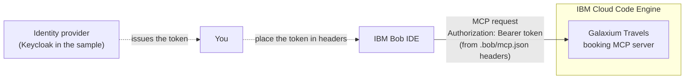

# Lab 5: Bob+ Extension, Building Blocks & Custom Modes

**Duration:** 20 minutes
**Goal:** Install the Bob+ extension, add Skills and Modes from the IBM Technology Building Blocks, and switch between specialized Bob modes.
**IBM Bob Version:** Authored with **IBM Bob 2.2.3**

> **📖 Documentation References:**
> - [Bob+ Extension Installation Guide](https://ibm-self-serve-assets.github.io/building-blocks-docs/ibm-bob/extension/install/) (Bob+ IBM Technology Building Blocks Docs)
> - [Bob+ extension source and `.vsix` download (GitHub)](https://github.com/ibm-self-serve-assets/building-blocks/tree/main/ibm-bob/extension)
> - [Skills for Bob+ IBM Technology Building Blocks](https://ibm-self-serve-assets.github.io/building-blocks-docs/ibm-bob/skills/)
> - [Authoring & Configuring Custom Modes](https://bob.ibm.com/docs/ide/configuration/custom-modes) (`docs/ide/configuration/custom-modes`)
> - [Standardizing Bob's Behavior across Workspaces](https://bob.ibm.com/docs/ide/tutorials/standardize-bobs-behavior) (`docs/ide/tutorials/standardize-bobs-behavior`)

---

> **🧭 Where do I type?** 💬 = **Bob chat** (agentic sidebar). 🖥️ = **your own terminal** (**Terminal → New Terminal**). 📝 = **file in the editor**. Never paste shell commands into the Bob chat. See [Where Do I Type This?](README.md#where-do-i-type-this-chat-vs-terminal-vs-editor).

---

## 1. Objectives

By the end of this lab, you will:
- Install the **Bob+ extension** (`.vsix`) in IBM Bob.
- Browse and install **Skills** and **Modes** from the IBM Technology Building Blocks via the **B+** view.
- (Optional) Import custom specialized modes from external configuration templates.
- (Optional, reading only) See how a remote MCP server on IBM Cloud Code Engine could be registered with a bearer token.
- Switch between specialized modes (e.g. Spec-Driven Development, Architecture Review).
- Understand Global (cloud/tenant) vs Local (workspace) configuration strategies.

---

## 2. Step-by-Step Instructions

### Step 5.1: Install the Bob+ Extension
Make sure a project folder is open in IBM Bob first. Steps follow the [Bob+ Extension Installation Guide](https://ibm-self-serve-assets.github.io/building-blocks-docs/ibm-bob/extension/install/).

1. **Download the VSIX:** open the [building-blocks extension page on GitHub](https://github.com/ibm-self-serve-assets/building-blocks/tree/main/ibm-bob/extension) and download the latest `bob-plus-assets-<version>.vsix` file (for example `bob-plus-assets-1.1.0.vsix`).
2. **Install in IBM Bob:**
   * Open the **Extensions** panel (`Cmd+Shift+X` on macOS / `Ctrl+Shift+X` on Windows/Linux) or **View → Extensions**.
   * Click the three-dots menu (`···`) in the top right of the panel → **Install from VSIX…**
   * Choose the downloaded `.vsix` file and click **Open**.
3. **Reload the window** when prompted, or run `Developer: Reload Window` from the Command Palette (`Cmd+Shift+P` / `Ctrl+Shift+P`).

You only need to install the extension once.

---

### Step 5.2: Install Skills and Modes with Bob+
1. Click the **B+** icon in the Activity Bar on the left. Bob+ opens and shows **Modes** and **Skills**, grouped by domain. No GitHub token is required (it uses the public GitHub API).
2. Use the search bar to find a Skill or Mode by name or domain.
3. Click **Install** on a Mode or Skill card.
4. Verify where the assets landed in your workspace:
   * Skills are installed into `.bob/skills/`
   * Modes are merged into `.bob/custom_modes.yaml`
5. To remove an asset, click **Uninstall** on its card. Updating the extension later does not affect assets already installed in `.bob/`.

You can then 💬 **in the Bob chat** ask Bob to confirm what is available:
```markdown
List all skills in .bob/skills/ and all modes defined in .bob/custom_modes.yaml.
```

> **Alternative (Skills only):** the Skills are also published as a single `.zip` on the [Skills page](https://ibm-self-serve-assets.github.io/building-blocks-docs/ibm-bob/skills/). Copy the skill folders to `~/.bob/skills` (global) or `<project>/.bob/skills` (project level).

---

### Step 5.3: Specialized Mode Switching
Bob features persona-driven modes with custom toolsets and system prompts:

1. 💬 **In the Bob chat** (or with the mode selector next to the chat input), switch to **Spec-Driven Development** mode:
   ```markdown
   Switch to "Spec-Driven Development" mode.
   ```
2. 💬 **In the Bob chat**, prompt Bob for a specification document:
   ```markdown
   Draft an API Specification (OpenAPI format) for extending our Express microservice with authentication and pagination.
   ```
3. 💬 **In the Bob chat**, switch back to **Agent** mode:
   ```markdown
   Switch to "Agent" mode.
   ```

---

### Step 5.4 (Optional): Importing Custom Modes from Configuration Template Repository
You can import a rich collection of predefined custom modes (Architecture Review, Threat Modeling, Spec-Driven Development, 12-Factor, etc.) from the [`review_and_sdd_custom_ibm_bob_configuration_template`](https://github.com/thomassuedbroecker/review_and_sdd_custom_ibm_bob_configuration_template.git) repository.

#### Option A: Ask Bob to fetch and configure the modes — 💬 **Bob chat**
Prompt Bob directly in the chat:
```markdown
Fetch the custom modes from https://raw.githubusercontent.com/thomassuedbroecker/review_and_sdd_custom_ibm_bob_configuration_template/main/.bob/custom_modes.yaml and save them to .bob/custom_modes.yaml
```

#### Option B: Download via CLI — 🖥️ **Terminal** (repository root)
Run the following curl command **in your own terminal, not in the Bob chat**:
```bash
curl -o .bob/custom_modes.yaml https://raw.githubusercontent.com/thomassuedbroecker/review_and_sdd_custom_ibm_bob_configuration_template/main/.bob/custom_modes.yaml
```

#### Available Modes in the Template:
* **🧭 Spec-Driven Development (`sdd`):** Requirements clarification, OpenAPI/spec authoring, and SDLC traceability.
* **🏛️ Architecture Review (`arch-review`):** Comprehensive 7-area architecture evaluations and trade-off analysis.
* **🔒 Security & Threat Modeling (`security-review`):** STRIDE threat modeling, OWASP Top 10, and security assessments.
* **📈 Scalability & Performance (`scalability-review`):** Bottleneck analysis, caching strategies, and capacity planning.
* **☁️ 12-Factor Compliance (`twelve-factor-review`):** Cloud-native readiness and 12-factor audit.
* **📊 Draw.io (`drawio`):** Visual architecture diagram generation and updates.

Once imported, switch into any of the modes using the mode selector dropdown in Bob or 💬 **in the Bob chat** via prompt:
```markdown
Switch to "Architecture Review" mode.
```

---

### Step 5.5 (Optional, reference only): A Deployed IBM Code Engine Service Secured with OAuth 2.0
This step is a **reading exercise**. It points to a sample deployment by the workshop author and shows how a remote MCP server on **IBM Cloud Code Engine** could be registered in Bob. It needs your own IBM Cloud account and can cause cloud charges (see the cost notice in the [workshop overview](README.md)). You do not need it to finish the workshop.



The sample comes from the [`galaxium-travels-infrastructure-tsuedbro`](https://github.com/thomassuedbroecker/galaxium-travels-infrastructure-tsuedbro) repository (Apache-2.0). It deploys the services with **Keycloak** as the OAuth 2.0 / OpenID Connect provider. See its [`deploy.env.oauth2.template`](https://github.com/thomassuedbroecker/galaxium-travels-infrastructure-tsuedbro/blob/main/deployment/ibm-code-engine/deploy.env.oauth2.template) and the repository README for the exact steps. Check the current names there, because the file can change.

#### 1. Deployment configuration (excerpt)
📖 **Reference only.** An excerpt of the variable names in `deploy.env.oauth2.template` at the time of writing. They are set for the deployment scripts of that repository, not in this workspace and not in the Bob chat. Never put real secrets in a file in this repository:

```bash
CE_PROJECT_NAME=galaxium-travels-oauth2
KEYCLOAK_REALM=galaxium
OIDC_AUDIENCE=booking-api
OIDC_CLIENT_ID=web-app-proxy
OIDC_SCOPE="openid profile email"
OIDC_CLIENT_SECRET=change-me        # secret: replace it, never commit the real value
```

#### 2. Registering the deployed MCP server in `.bob/mcp.json`
📝 **Editor:** the Bob documentation describes remote servers with `type`, `url` and `headers` (see [Using MCP in Bob](https://bob.ibm.com/docs/ide/configuration/mcp/mcp-in-bob)). Bob does not document an `auth: { "type": "oauth2" }` block, so obtain an access token from your identity provider and place it in `headers`. Replace the placeholders with the values of **your** deployment (the sample repository documents the MCP endpoint path). Keep `.bob/mcp.json` out of Git:

```json
{
  "mcpServers": {
    "galaxium-travels-ce": {
      "type": "streamable-http",
      "url": "https://<your-mcp-app>.<project-hash>.<region>.codeengine.appdomain.cloud/<mcp-path>",
      "headers": {
        "Authorization": "Bearer <access-token-from-your-identity-provider>"
      },
      "alwaysAllow": [],
      "disabled": false
    }
  }
}
```

#### 3. Interacting with the deployed service
Access tokens expire. When the server rejects your requests, get a new token and update the header. Then 💬 **in the Bob chat**, prompt Bob to use the tools the server offers:
```markdown
List the tools of the `galaxium-travels-ce` MCP server and describe what each tool does.
```

---

### Step 5.6: Global vs. Local Configuration Review

| Aspect | **Global (User Level)** | **Local (Workspace Level)** |
| :--- | :--- | :--- |
| **Location** | `~/.bob/` (for example `~/.bob/rules/`, `~/.bob/mcp.json`) | `.bob/` in the project root (for example `.bob/rules/`, `.bob/mcp.json`), plus `AGENTS.md` |
| **Scope** | All your workspaces | Only the current folder/repo. Project MCP settings take precedence over global ones when server names conflict. |
| **Best Used For** | Personal standards and servers you want everywhere | Team-shared project rules (via version control) and local experiments. Do not commit tokens. |

See [Using MCP in Bob](https://bob.ibm.com/docs/ide/configuration/mcp/mcp-in-bob) (configuration levels) and [Custom Rules](https://bob.ibm.com/docs/ide/configuration/rules).

---

## 3. Workshop Wrap-Up Checklist

📖 **Read only** (a checklist for you, not a prompt for Bob and not a command):

```markdown
[x] Lab 1: Workspace context, symbol navigation, and rule adherence
[x] Lab 2: Git branch creation, semantic commits, and PR descriptions
[x] Lab 3: Node.js Express microservice with sliding-window rate limiting
[x] Lab 4: Local SQLite MCP server and authenticated remote MCP servers
[x] Lab 5: Bob+ extension, building blocks, custom modes, and remote MCP reference
```
