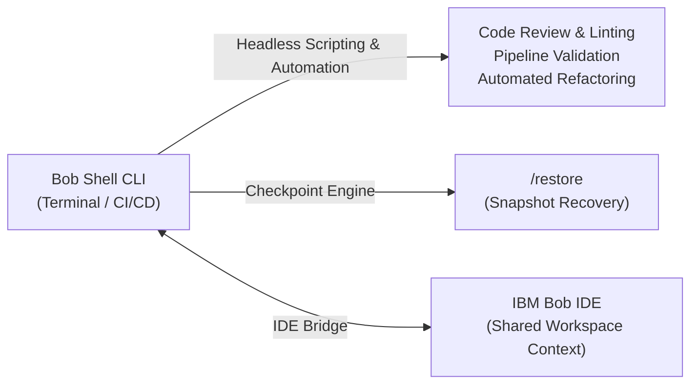
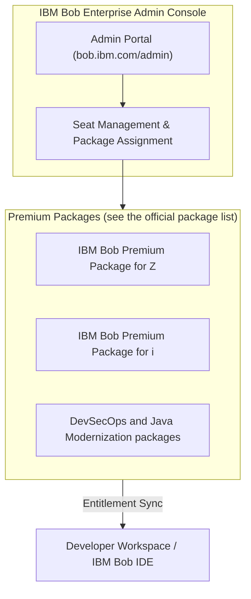
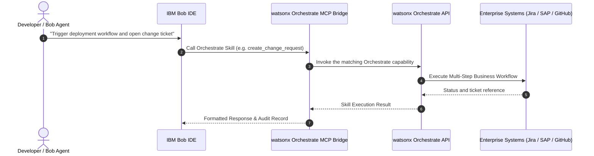
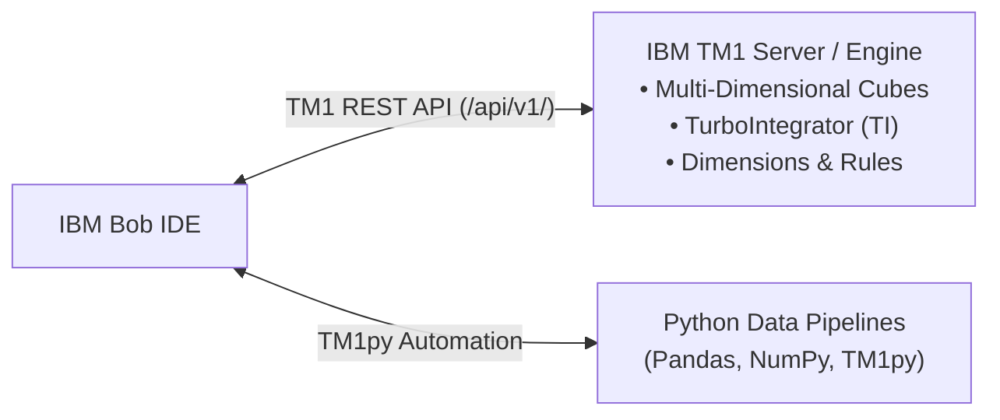
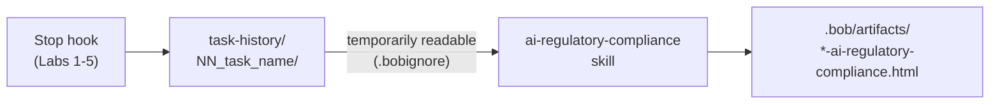

# Lab 6: Future Steps — Bob CLI, Premium Packages & Enterprise Integrations

**Duration:** 40 minutes (optional)  
**Goal:** Explore advanced operational extensions for IBM Bob: leveraging the Bob Shell CLI for headless/DevOps automation, activating enterprise Premium Packages, and orchestrating workflows across IBM watsonx Orchestrate and IBM Planning Analytics (TM1). Close the workshop by generating AI regulatory compliance provenance documentation from your own task history.  
**IBM Bob Version:** Authored with **IBM Bob 2.2.3**

> **📖 IBM Bob Official Documentation References:**
> - [Bob Shell CLI & Terminal Workflows](https://bob.ibm.com/docs/shell) (`docs/shell`)
> - [Enterprise Premium Packages](https://bob.ibm.com/docs/ide/premium-packages/pkg-index) (`docs/ide/premium-packages/pkg-index`)
> - [Managing Users & Add-On Seats](https://bob.ibm.com/docs/ide/enterprise/getting-started/users) (`docs/ide/enterprise/getting-started/users`)
> - [IBM watsonx Orchestrate Official Documentation](https://www.ibm.com/docs/en/watsonx/watson-orchestrate)
> - [IBM Planning Analytics Documentation](https://www.ibm.com/docs/en/planning-analytics)

> **🧭 Where do I type?** 💬 = **Bob chat** (agentic sidebar). 🖥️ = **your own terminal**. Never paste shell commands into the Bob chat. See [Where Do I Type This?](README.md#where-do-i-type-this-chat-vs-terminal-vs-editor).

---

## 1. Objectives

By the end of this lab, you will:
- Understand how to leverage **Bob Shell (CLI)** for command-line workflows, CI/CD pipeline automation, and checkpoint recovery.
- Learn how **Enterprise Premium Packages** extend Bob with specialized capabilities for specific platforms and modernization workflows.
- Explore integration patterns between Bob and **IBM watsonx Orchestrate** digital workers.
- Understand how Bob interfaces with **IBM Planning Analytics (TM1)** via REST APIs, MDX queries, and TM1py automation.
- Use the **`ai-regulatory-compliance` skill** to document how your workshop apps were built with Bob, based on the exported `task-history/`.

---

## 2. Step-by-Step Exploration

### Step 6.1: IBM Bob CLI (Bob Shell) for Terminal & DevOps Automation

Bob Shell (started with the `bob` command) brings IBM Bob’s reasoning and context awareness directly into your command-line environment and CI/CD pipelines. See [Install and set up Bob Shell](https://bob.ibm.com/docs/shell/getting-started/install-and-setup) for installation. On first start you log in with your IBMid and accept the license agreement.



#### Key Capabilities:
1. **Interactive Terminal Mode:** 🖥️ **Terminal** — launch Bob Shell from any terminal (outside the Bob chat):
   ```bash
   bob
   ```
2. **Headless & Scripted Execution:** 🖥️ **Terminal** — execute one-off commands and pipeline checks (accept the license once first, for example with an interactive session or `bob --accept-license -p "Explain this project"`):
   ```bash
   bob -p "Audit all JavaScript files for unhandled Promise rejections and return a Markdown summary"
   ```
3. **Session Checkpointing & Restore:** Bob Shell tracks automatic checkpoints before executing file modifications. 🖥️ **Inside a running Bob Shell session** (not in the IDE chat and not in a normal shell), type the slash command:
   ```bash
   /restore
   ```
4. **IDE Companion Bridge:** When run inside IBM Bob's integrated terminal, Bob Shell offers to connect to the IDE. After you accept, it sees your recent files and cursor position, and shows suggested changes in the IDE diff viewer (see the Bob Shell documentation, section "Integrating with Bob IDE").

---

### Step 6.2: Enterprise Premium Packages & Add-Ons

For enterprise organizations, IBM Bob provides modular **Premium Packages** managed centrally through the [IBM Bob Administration Console](https://bob.ibm.com/admin).



#### Administration & Allocation:
* **Central Policy:** Enterprise administrators assign premium packages per user in the [IBM Bob Administration](https://bob.ibm.com/admin) page under **Users & Teams** → **Users** → **Premium packages**. Entitlements are time-bound.
* **Zero Client Reinstall:** When assigned, capabilities and specialized tools activate dynamically in the developer's IBM Bob environment.

---

### Step 6.3: IBM watsonx Orchestrate Integration

IBM watsonx Orchestrate is IBM's offering for automating business workflows with AI agents. See the [watsonx Orchestrate documentation](https://www.ibm.com/docs/en/watsonx/watson-orchestrate) for the current capabilities and supported integrations.

> **ℹ️ Conceptual pattern, not a tested setup.** The diagram below is an illustration of one possible design. It is not taken from IBM documentation, and the names in it (`MCP Bridge`, `create_change_request`) are examples. Check the Orchestrate documentation for how it can be exposed to other tools before you build this.



#### Integration Pattern:
1. **Expose Orchestrate through an MCP server (design idea):** if you provide an MCP server in front of Orchestrate, register it in your local `.bob/mcp.json` like any other remote server (see [Lab 4, Step 4.4](lab-4-mcp-integration.md)). Keep tokens out of Git.
2. **Seamless Tool Dispatch:** Prompt Bob in natural language to execute business tasks (e.g., creating Jira epics, scheduling release reviews, syncing service catalogues) directly while developing code.

---

### Step 6.4: IBM Planning Analytics (TM1) Integration

IBM Planning Analytics with TM1 provides multi-dimensional OLAP cubes and financial modeling engines. Bob can accelerate TM1 development, TurboIntegrator (TI) process scripting, and data analytics.



#### Integration Possibilities:
1. **TurboIntegrator (TI) & Rules Generation:** 💬 **In the Bob chat**, instruct Bob to author optimized TM1 rule syntax, feeder statements, and TI data import scripts:
   ```markdown
   Generate a TurboIntegrator script that imports monthly expense CSV data into the `Capex_Plan` TM1 cube and calculates currency conversions.
   ```
2. **MDX Query Construction:** Generate and test multi-dimensional MDX queries against TM1 cubes.
3. **TM1py Scripting:** Scaffold Python automation workflows using the `TM1py` package (open source, by Cubewise) to extract dimension elements, write back cell values, and validate model integrity.
4. **TM1 REST API MCP Integration:** Connect a custom MCP server to query cube dimensions and cellsets directly into Bob's chat interface.

---

### Step 6.5: Wrap-Up — Document How You Built Your Apps with Bob (`ai-regulatory-compliance` skill)

The workspace includes the `ai-regulatory-compliance` skill in [`.bob/skills/ai-regulatory-compliance/`](../.bob/skills/ai-regulatory-compliance/SKILL.md). It documents **how the apps were built with an AI coding assistant** (EU AI Act Art. 13, 14, 16, 50 and GDPR Art. 5, 22, 25), based on the sessions exported to `task-history/`. It does **not** assess AI features of the apps themselves. This is documentation support for a consultant, not legal advice.



#### Prerequisites

1. **Task history exists.** 🖥️ **Terminal:** check that `task-history/` contains numbered folders from your earlier labs (named tasks give readable folder names, see the "Name your Bob tasks" notes in Labs 1–4):
   ```bash
   ls task-history/
   ```
   *Expected: folders such as `01_...`, `02_...`, each with a `bob-task-<id>-<date>.json` file. If the folder is empty, the hook did not run (see [Workspace Trust](README.md#prerequisites)) or you can export manually with `node .bob/hooks/export-task-history.mjs`.*
2. **Let Bob read the exports (temporarily).** [`.bobignore`](../.bobignore) lists `task-history/`, so Bob cannot read the exports by default. 📝 **Editor:** open [`.bobignore`](../.bobignore) and put a `#` in front of the `task-history/` line:
   ```text
   # task-history/
   ```
   > **Why this is a conscious step:** The exports contain your complete prompts, tool output and local paths. Only do this in a workshop workspace, and restore the line when you are done (see step 6.5.3). Never commit `task-history/` (it is already covered by [`.gitignore`](../.gitignore)).

#### Run the skill

💬 **In the Bob chat** (title the task, for example `"Lab 6 - Compliance provenance"`), send this prompt:

```markdown
Use the ai-regulatory-compliance skill to create an AI Regulatory Compliance Provenance document for the apps we built in this workshop (workshop-apps/). Base it on the task history in task-history/. Ask me for any facts you cannot find in the project, and mark anything I do not confirm as "[consultant to confirm]".
```

Bob asks you for facts it cannot find in the project (client or project name, human oversight policy, risk classification, whether personal data was processed, contact). Answer them, or leave a field open: Bob then marks it `[consultant to confirm]`. For the workshop you can use fictional values.

*Expected result:* a Markdown compliance summary in the chat and a self-contained HTML file `.bob/artifacts/<project-slug>-ai-regulatory-compliance.html`. Open it in a browser and check the gaps and remediation actions it lists.

#### Restore the protection

📝 **Editor:** remove the `#` again so that [`.bobignore`](../.bobignore) contains `task-history/` as before. 🖥️ **Terminal:** verify that no exports would be committed:

```bash
git status --short -uall | grep task-history
```

*Expected: no output (or only `task-history/README.md`).*

---

## 3. Official Resource & Documentation Hub

| Solution / Capability | Official Resource Link | Description |
| :--- | :--- | :--- |
| **IBM Bob Shell (CLI)** | [Bob Shell Documentation](https://bob.ibm.com/docs/shell) | Official guide to installation, headless execution, tools, and `/restore` checkpoints. |
| **IBM Bob Premium Packages** | [Premium Packages Overview](https://bob.ibm.com/docs/ide/premium-packages/pkg-index) | Overview of the available premium packages and how to update them. |
| **IBM Bob Enterprise Administration** | [User & Role Management](https://bob.ibm.com/docs/ide/enterprise/getting-started/users) | Managing organization users, roles, seats and premium package assignment. |
| **IBM watsonx Orchestrate** | [watsonx Orchestrate Docs](https://www.ibm.com/docs/en/watsonx/watson-orchestrate) | Product documentation for IBM watsonx Orchestrate. |
| **IBM Planning Analytics (TM1)** | [Planning Analytics Documentation](https://www.ibm.com/docs/en/planning-analytics) | Product documentation, including TM1 modeling, TurboIntegrator and the TM1 REST API. |
| **TM1py Community Library** | [TM1py GitHub Repository](https://github.com/cubewise-code/tm1py) | Open-source (MIT) Python library for the TM1 REST API, maintained by Cubewise. It is a community project, not an IBM product. |
| **Model Context Protocol (MCP)** | [Model Context Protocol website](https://modelcontextprotocol.io) | Open standard for connecting AI assistants to enterprise data sources and custom tools. |
