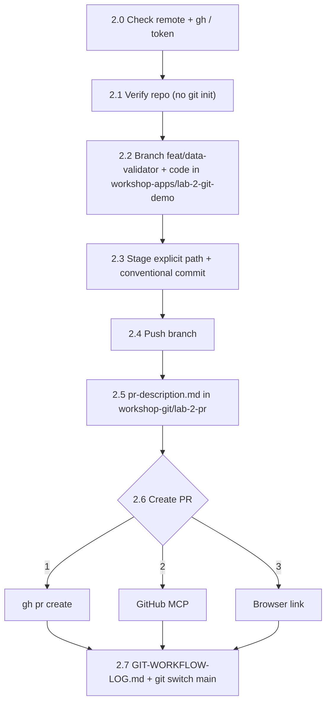

# Workshop Git Artifacts (`workshop-git/`)

This folder holds files produced by the **Git and pull request workflow** in [Lab 2](../workshop-documentation/lab-2-git-workflows.md). It keeps these files out of the repository root and out of your pull request.

```text
workshop-git/
├── README.md                  # This file (part of the template)
└── lab-2-pr/                  # Created during Lab 2
    ├── pr-description.md      # PR body: Summary, Breaking Changes, Testing Checklist
    └── GIT-WORKFLOW-LOG.md    # Record: branch, commit, push result, PR URL, problems
```

## Rules
- Only Git/PR artifacts belong here. Application code goes to [`workshop-apps/`](../workshop-apps/).
- Files in `lab-2-pr/` are local artifacts. They are used as the PR body (`--body-file`) and are **not** committed to the feature branch.
- Never write tokens or secrets into these files.
- Bob task history exports stay in `task-history/` and are never staged.

## Workflow Overview


